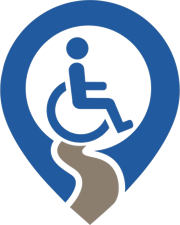

<p align="center">
  
</p>

<h1 align="center">Ovunque Accessibile</h1>

<p align="center">
  <strong>Luoghi accessibili in tutta Italia, spiegati in modo chiaro.</strong><br>
  Ingresso, bagno, parcheggio e spazi interni, raccontati da chi ci è stato davvero.
</p>

<p align="center">
  <a href="https://mockly-website.github.io/ovunque-accessibile/">Sito</a> ·
  <a href="https://mockly-website.github.io/ovunque-accessibile/app/">Web-app</a> ·
  <a href="https://www.instagram.com/ovunque_accessibile">Instagram</a> ·
  <a href="https://www.facebook.com/profile.php?id=61592189935247">Facebook</a> ·
  <a href="mailto:ovunqueaccessibile@gmail.com">Email</a> ·
  <a href="https://wa.me/393518332819">WhatsApp</a>
</p>

---

> L’accessibilità non dovrebbe essere un privilegio, ma la normalità.

## Cos'è

Ovunque Accessibile nasce da Angelo e Lorenzo, due ragazzi che si muovono in carrozzina e sanno quanto conta sapere **prima** se un posto è davvero accessibile: un gradino in più, una porta stretta o un bagno non attrezzato possono rovinare una giornata.

Il progetto raccoglie in una mappa ristoranti, musei, spiagge, negozi, hotel e servizi, con informazioni concrete invece di simboli generici. Ogni scheda dice cosa si trova all'ingresso, dentro e in bagno, quanto è affidabile l'informazione e quando è stata controllata l'ultima volta.

## Cosa si può fare

- **Cercare sulla mappa** per città, nome o tipo di luogo, anche con i suggerimenti mentre si scrive.
- **Scegliere la propria esigenza**: carrozzina manuale, carrozzina elettrica, difficoltà a camminare, persona anziana. Lo stesso gradino è un ostacolo diverso per ognuno, quindi il giudizio cambia in base a chi lo legge.
- **Leggere la scheda di un luogo**: ingresso, porta, spazi, piani e ascensore, bagno, parcheggio, foto, recensioni e avvisi temporanei (per esempio un ascensore guasto).
- **Trovare i bagni accessibili vicini** con un tocco.
- **Segnalare un luogo nuovo o correggerne uno**: ogni segnalazione viene controllata da un moderatore prima di essere pubblicata.
- **Salvare i preferiti** e ritrovarli anche senza connessione.
- **Per i locali**: chi gestisce un locale può chiederne la gestione, mettere in vetrina il codice QR e richiedere la verifica sul posto, che dà il bollino «Verificato sul posto».

## Quanto sono affidabili i dati

Ogni luogo dice da dove arriva l'informazione:

| Livello | Cosa significa |
|---|---|
| ★ **Verificato sul posto** | Il team è andato di persona a controllare. Dopo 24 mesi la scheda torna «da ricontrollare». |
| **Segnalato dalla community** | Inviato da chi ci è stato e approvato da un moderatore. |
| **Da OpenStreetMap** | Dati pubblici di OpenStreetMap, ancora da verificare. |

Non c'è nessun dato inventato: quando un'informazione manca, la scheda dice «Da verificare».

## Accessibilità del sito

Il sito e la web-app sono pensati prima di tutto per chi li usa:

- obiettivo **WCAG 2.2 livello AA**, con contrasti verificati;
- pulsante **Alto contrasto** su tutte le pagine;
- font **Atkinson Hyperlegible**, progettato per la massima leggibilità;
- tutto usabile da **tastiera** e con **screen reader** (VoiceOver, TalkBack);
- pulsanti grandi, niente gesti obbligatori, rispetto di «riduci movimento».

## Privacy

Niente pubblicità, niente tracciamento, niente servizi di terze parti caricati nelle pagine. La posizione, quando si usa «Vicino a me», resta nel browser e non viene mai inviata. I dettagli sono nella [privacy del sito](https://mockly-website.github.io/ovunque-accessibile/privacy.html) e in quella della [web-app](https://mockly-website.github.io/ovunque-accessibile/app/privacy.html).

## La web-app sul telefono

La web-app si apre dal browser e si può aggiungere alla schermata Home, come un'app vera, senza passare dagli store. Le istruzioni per iPhone e Android sono nella pagina [Mettila sulla schermata Home](https://mockly-website.github.io/ovunque-accessibile/installa.html). Un'app per Android è in preparazione.

## Come è fatto

- **Sito e web-app**: HTML, CSS e JavaScript senza framework né passaggi di compilazione, pubblicati con GitHub Pages.
- **Mappa**: [Leaflet](https://leafletjs.com) con le mappe di [OpenStreetMap](https://www.openstreetmap.org).
- **Dati e account**: [Supabase](https://supabase.com) (database PostgreSQL con regole di accesso per ogni tabella).
- **Web-app installabile** con service worker, utilizzabile anche senza connessione per i luoghi già visti.

### Struttura

```
index.html, mappa.html, luogo.html, locali.html, installa.html, privacy.html   pagine del sito
assets/          stili, script, font, immagini e librerie del sito
app/             la web-app (mappa, schede, segnalazioni, profilo, moderazione)
```

### Provarlo in locale

Serve solo un server statico, per esempio:

```bash
python3 -m http.server 8000
```

poi aprire `http://localhost:8000/`.

## Crediti e licenze

- Dati delle mappe © [contributori di OpenStreetMap](https://www.openstreetmap.org/copyright), licenza ODbL.
- [Leaflet](https://leafletjs.com) (BSD 2-Clause) e [Leaflet.markercluster](https://github.com/Leaflet/Leaflet.markercluster) (MIT).
- [supabase-js](https://github.com/supabase/supabase-js) (MIT).
- [QR Code Generator](https://github.com/kazuhikoarase/qrcode-generator) di Kazuhiko Arase (MIT).
- Icone [Tabler Icons](https://tabler.io/icons) (MIT).
- Font [Atkinson Hyperlegible](https://www.brailleinstitute.org/freefont/) e [Fredoka](https://fonts.google.com/specimen/Fredoka) (SIL Open Font License).

## Contatti

- Instagram: [@ovunque_accessibile](https://www.instagram.com/ovunque_accessibile)
- Facebook: [Ovunque Accessibile](https://www.facebook.com/profile.php?id=61592189935247)
- Email: [ovunqueaccessibile@gmail.com](mailto:ovunqueaccessibile@gmail.com)
- WhatsApp e telefono: [351 833 2819](https://wa.me/393518332819)

---

<p align="center">Sito e web-app realizzati da <a href="https://mockly.it">Mockly</a>.<br>© 2026 Ovunque Accessibile</p>
